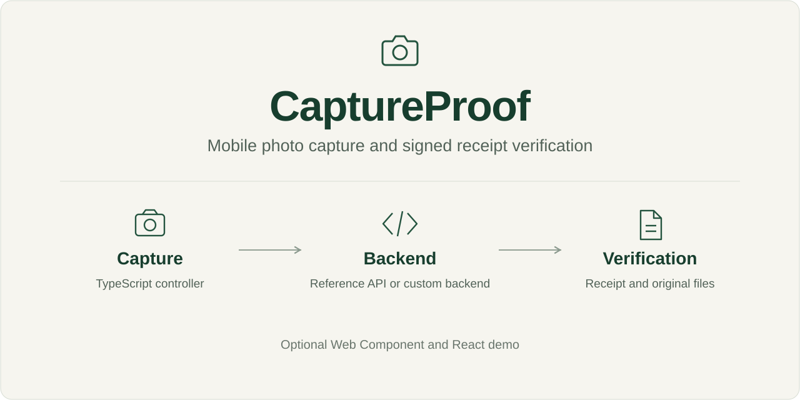

<p align="center">
  
</p>

<p align="center">
  <a href="README.md">English</a> · <strong>Français</strong> · <a href="docs/fr/README.md">Documentation</a> · <a href="docs/fr/integration.md">Guide d’intégration</a>
</p>

<p align="center">
  <a href="https://github.com/coconut971/CaptureProof/actions/workflows/ci.yml"></a>
  <a href="LICENSE"></a>
  
  
  
</p>

# CaptureProof

**La capture photo mobile adaptée à votre application, avec des reçus vérifiables indépendamment lorsque vous en avez besoin.**

Utilisez le moteur TypeScript sans interface avec vos écrans et votre parcours. Ajoutez au besoin le Web Component fourni, l’API de référence ASP.NET Core ou la démonstration React. Le vérificateur de reçus fonctionne seul, sans appeler de serveur.

CaptureProof est une implémentation de référence fonctionnelle. Le reçu lie **les octets exacts des fichiers acceptés et le contexte métier déclaré**. Il n’atteste ni l’origine physique de la caméra, ni l’authenticité d’un objet, ni l’absence d’IA, ni une heure de confiance indépendante.

## Choisir les modules utiles

| Votre objectif | Point de départ | Ce que vous pouvez remplacer |
| --- | --- | --- |
| Construire votre écran de capture | [`@captureproof/capture-web/headless`](packages/capture-web/README.fr.md) | Interface, étapes, navigation et transport |
| Intégrer un contrôle prêt à l’emploi | [`<capture-proof>`](examples/vanilla/README.fr.md) | Application autour du composant et transport |
| Capturer localement sans reçu signé | [`capture-only`](docs/fr/integration.md) | Interface et traitement des JPEG obtenus |
| Émettre des reçus dans votre parcours | [`CaptureTransport` et backend compatible](docs/fr/protocol.md) | Backend et autorisation métier |
| Vérifier un reçu et ses fichiers | [`@captureproof/receipt-verifier`](packages/receipt-verifier/README.fr.md) | Application et source des clés publiques reconnues |
| Explorer le parcours QR complet | [Démo React et API .NET de référence](docs/fr/architecture.md) | Écrans, intégration de l’identité et règles métier |

Le moteur ne dépend pas de React. Le point d’entrée sans interface ne charge pas le composant fourni. Votre backend peut utiliser un autre langage s’il respecte les contrats de transport et de reçu ; il conserve l’autorité sur les droits, les quotas et les octets acceptés.

## Votre interface, le même moteur

```ts
import { CaptureController } from '@captureproof/capture-web/headless';

const capture = new CaptureController({
  mode: 'capture-only',
  policy: {
    minPhotos: 1,
    maxPhotos: 3,
    maxBytesPerPhoto: 5 * 1024 * 1024,
    sessionTtlSeconds: 600,
  },
});

capture.addEventListener('change', () => renderYourScreen(capture.snapshot));
startButton.onclick = () => void capture.startCamera(videoElement);
shutterButton.onclick = () => void capture.capture();
finishButton.onclick = () => void capture.finalize();
// À la sortie de votre écran : capture.dispose();
```

`renderYourScreen`, les boutons et l’élément vidéo appartiennent à votre application. La capture utilise un navigateur mobile compatible, une origine HTTPS de confiance et une action explicite de l’utilisateur. Le [guide d’intégration](docs/fr/integration.md) décrit les événements de fin, les transports personnalisés, les reprises, le nettoyage et les reçus signés.

## Lancer la démonstration

Prérequis : **Node.js 24**, **SDK .NET 10.0.402** et **runtime ASP.NET Core 10.0.13**. Les versions des dépendances sont verrouillées.

```sh
npm ci
npm run build
```

Sous Windows :

```powershell
pwsh -File scripts/install-dotnet.ps1  # installation locale facultative du SDK
pwsh -File scripts/start-demo.ps1
```

Sous Linux :

```sh
ASPNETCORE_ENVIRONMENT=Development \
ASPNETCORE_URLS=http://localhost:5080 \
CaptureProof__DataDirectory="$PWD/.data/demo" \
dotnet run --no-launch-profile --project src/CaptureProof.Api
```

Ouvrir [la démonstration locale](http://localhost:5080). Cette adresse HTTP de boucle locale sert au développement sur ordinateur. Un téléphone nécessite une origine **HTTPS** commune et reconnue : suivre le [guide HTTPS](docs/fr/https.md). L’origine QR par défaut `https://localhost:7443` ne permet pas de joindre l’ordinateur depuis un autre appareil.

Pour développer le frontend, garder l’API active et lancer `npm run dev` dans un second terminal. La démo React écoute sur le port 5173 et transmet les appels API au port 5080.

## Réutiliser les packages

Les packages ne sont **pas publiés sur le registre npm**. Construire les archives locales :

```sh
npm ci
npm run build
node scripts/package-npm.mjs
```

Puis installer l’archive utile dans votre projet :

```sh
npm install /chemin/vers/CaptureProof/artifacts/captureproof-capture-web-0.1.0.tgz
# Le vérificateur s’installe indépendamment avec son archive.
```

Consulter le [package de capture](packages/capture-web/README.fr.md), le [vérificateur](packages/receipt-verifier/README.fr.md) et le [guide d’intégration](docs/fr/integration.md).

## Documentation

- **Intégrer :** [intégration](docs/fr/integration.md), [architecture](docs/fr/architecture.md), [protocole HTTP](docs/fr/protocol.md), [format du reçu](docs/fr/receipt.md).
- **Exploiter l’API de référence :** [HTTPS](docs/fr/https.md), [configuration et Docker](docs/fr/operations.md), [sauvegarde et restauration](docs/fr/backup-restore.md).
- **Évaluer les garanties :** [menaces](docs/fr/threat-model.md), [validations](docs/fr/testing.md), [sécurité](SECURITY.fr.md), [dépendances](docs/fr/dependencies.md).
- **Contribuer ou adapter :** [contribution](CONTRIBUTING.fr.md), [licence Apache-2.0](LICENSE), [documentation anglaise](docs/README.md).

## Validation

Le [bilan des validations](docs/fr/testing.md) distingue contrôles automatiques, observations sur appareils réels et limites connues. Des parcours ont été réalisés sur iPhone/Safari et Xiaomi/Mi Browser, dont une reprise Wi-Fi et un verrouillage court avec une photo en attente sur le Xiaomi. Les versions exactes n’ont pas été relevées ; Chrome Android n’a pas été testé sur appareil réel.

```sh
npm run typecheck
npm run lint
npm run build
dotnet restore CaptureProof.slnx --locked-mode
dotnet test CaptureProof.slnx --no-restore
npm test
npx playwright install chromium
npm run test:e2e
npm run audit:public
```

Pour les deux vérifications de fichiers .NET vers TypeScript, suivre la configuration du [guide de test](docs/fr/testing.md) ou lancer `pwsh -File scripts/interop.ps1`. Un test ignoré ne constitue pas une interopérabilité validée.

## Licence et périmètre

[Apache-2.0](LICENSE). Vous pouvez adapter les modules, créer votre interface et les intégrer à vos produits selon cette licence, en conservant les mentions de licence et de dépendances applicables.

La démo utilise une identité anonyme liée au navigateur et une conservation temporaire de 24 heures par défaut. Une intégration de production doit apporter son identité et son autorisation métier. Les JPEG en attente restent en mémoire et peuvent être perdus si la page est fermée, rechargée ou évincée. Consulter les [limites de sécurité et d’exploitation](SECURITY.fr.md) avant toute exposition publique de l’API de référence.
